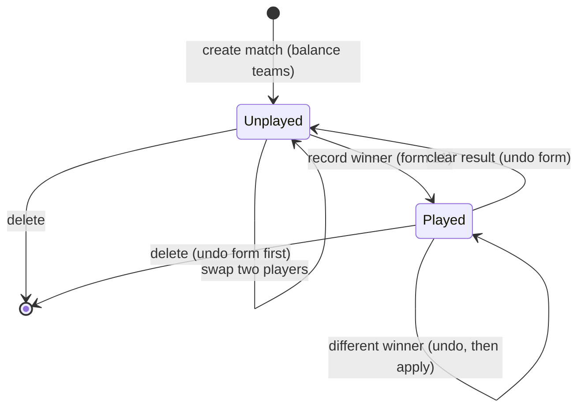
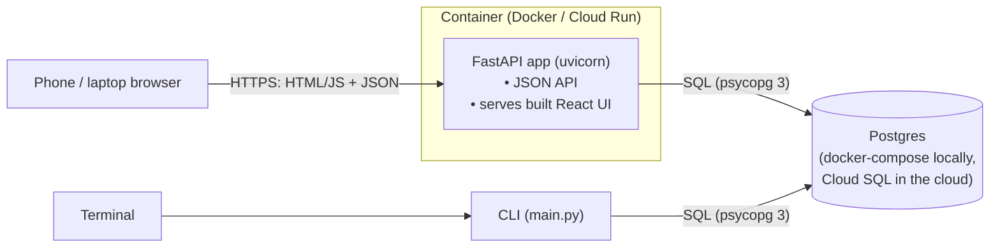
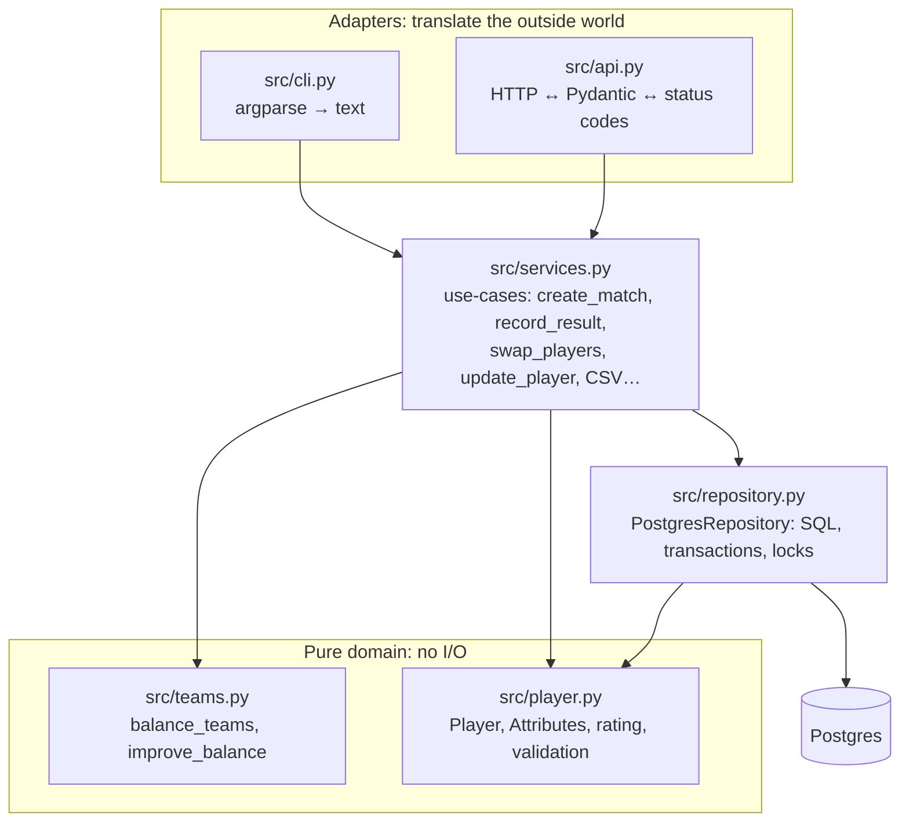
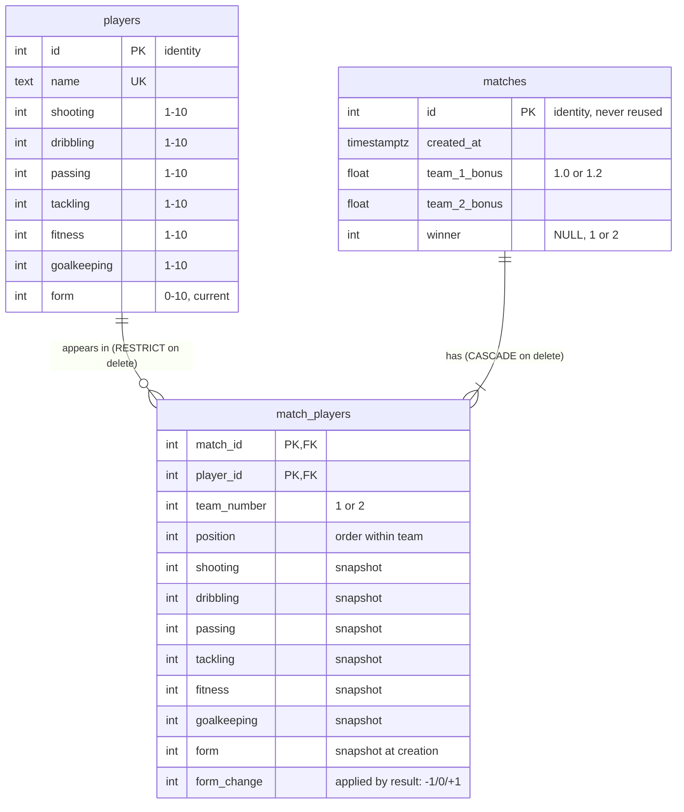
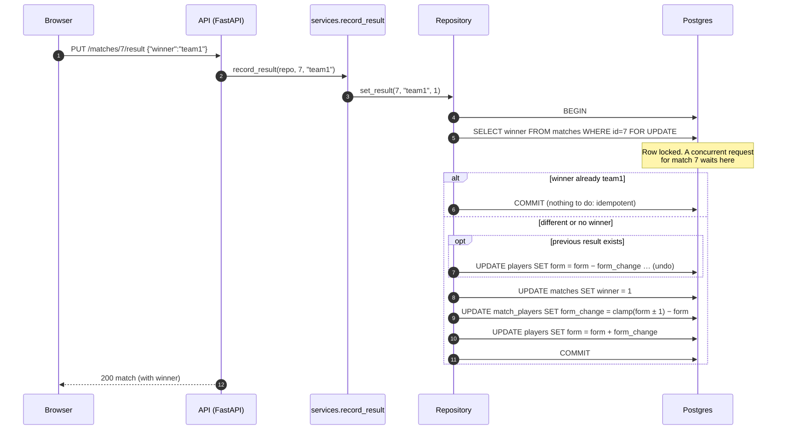
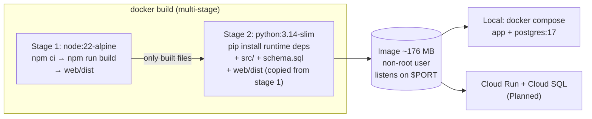
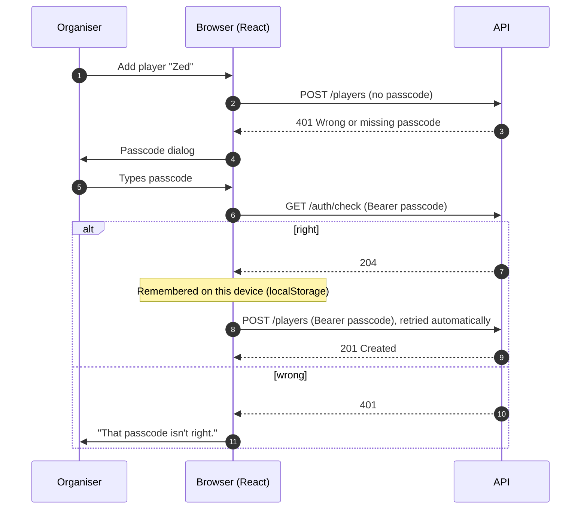

# Football Team Decider: Functional and Design Specification (FS-DS)

| | |
|---|---|
| **Status** | Living document. Describes the system as built, plus planned work (marked *Planned*) |
| **Scope** | Web UI, HTTP API, CLI, domain logic, Postgres storage, container packaging |
| **Out of scope** | League tables, scheduling, multiple groups/tenants, per-user accounts |

**Contents**
1. [Overview](#1-overview)
2. [Functional specification](#2-functional-specification): what it does
3. [Design specification](#3-design-specification): how it works
4. [Key decisions and trade-offs](#4-key-decisions-and-trade-offs)
5. [Testing strategy](#5-testing-strategy)
6. [Known limitations and roadmap](#6-known-limitations-and-roadmap)
7. [Glossary](#7-glossary)

---

## 1. Overview

### 1.1 Problem
A regular 5-a-side group has to split whoever turns up into two fair teams.
Picking by hand is slow and argued over, and it ignores who is playing well
lately. The group needs:

- a shared record of each player's skills,
- an automatic, explainable split into two balanced teams,
- a record of results, and a sense of "form" that moves with results so the
  next split reflects how people are actually playing.

### 1.2 Users
| User | Needs |
|---|---|
| **Organiser** (one or two people) | Add players, pick teams on match day, adjust by hand, record the winner, fix mistakes |
| **Players** | See the teams and the history on their phones, without seeing anyone's ratings |
| **Developer/maintainer** | Run it locally in one command, test it, deploy it |

### 1.3 Goals and non-goals
**Goals**
- Fair teams in under a second for a typical group (6 to 16 players).
- Results can be recorded, changed, cleared or deleted without leaving form
  wrong ("exactly undoable").
- Safe under retries and simultaneous use (two phones tapping "Team 1 won").
- Usable from a phone browser, an HTTP API and a terminal CLI, with identical
  rules.
- Cheap to host: scales to zero when unused.

**Non-goals (deliberately)**
- Per-user accounts and roles: a shared passcode is enough for one friend
  group (see §3.9).
- Perfectly optimal teams: "good and explainable" beats "provably optimal and
  slow" (see §4.3.1).
- Offline use, real-time push updates, multi-group tenancy.

---

## 2. Functional specification

### 2.1 Players

| ID | Requirement |
|---|---|
| F-P1 | A player has a unique **name** and six **skills**, each a whole number 1 to 10: shooting, dribbling, passing, tackling, fitness, goalkeeping |
| F-P2 | Names are 1 to 50 characters, start with a letter or digit, and may contain letters, digits, spaces and `' . -` (no `/`, so every name works in a URL). Surrounding whitespace is trimmed |
| F-P3 | Every player has a **form** from 0 to 10 (5 = average), starting at 5 |
| F-P4 | Any skill or form can be updated individually |
| F-P5 | A player who has appeared in any match **cannot be removed**, so history stays complete. Delete their matches first |
| F-P6 | "Reset forms" sets every player's form back to 5 (e.g. new season) |
| F-P7 | Players can be exported to and imported from CSV. Bad rows are skipped and reported, not fatal |
| F-P8 | Only passcode holders see skills, form and ratings (players' and teams'). Everyone else sees names, teams and results, with each team's players listed by name, since the balancer's order would hint at ratings |

**Rating.** A player's rating is a weighted average of their skills,
scaled by form:

```
base   = 0.30·shooting + 0.30·dribbling + 0.15·passing
       + 0.15·tackling + 0.05·fitness   + 0.05·goalkeeping      (1 to 10)
rating = base × (1 + 0.05 × (form − 5))                        (×0.75 to ×1.25)
```

Example: all skills 7 gives base 7.0. At form 5 the rating is 7.0, at form
10 it is 8.75, and at form 0 it is 5.25.

### 2.2 Matches (picking teams)

| ID | Requirement |
|---|---|
| F-M1 | Given at least 2 distinct, existing players, the system creates a **match** with two balanced teams |
| F-M2 | Team 1 gets ⌊n/2⌋ players, team 2 the rest. With an odd number, the larger team's rating is multiplied by **1.2** for balancing, to account for the extra player's value beyond their individual rating |
| F-M3 | A match **snapshots** each player's skills and form at creation. Later edits to a player don't rewrite past matches |
| F-M4 | Before a result is recorded, any two players on **opposite** teams can be swapped by hand. Each takes the other's exact position, so the list order doesn't jump around |
| F-M5 | A match can be **deleted** at any time (to re-pick, or remove a mistake). If it had a result, that result's form changes are undone first |
| F-M6 | Matches are shown by date (and time, if two share a day). Internal IDs exist but aren't shown in the UI |

### 2.3 Results and form

| ID | Requirement |
|---|---|
| F-R1 | Recording a winner moves each winner's form **+1** and each loser's **−1**, kept within 0 to 10 |
| F-R2 | Recording the **same** winner again changes nothing (idempotent, safe to retry) |
| F-R3 | Recording a **different** winner first undoes the old result's changes exactly, then applies the new one |
| F-R4 | **Clearing** a result undoes its form changes exactly and marks the match unplayed |
| F-R5 | "Exactly" means each player moves back by the amount they actually moved. A player already at 10 who won moved 0, so undoing moves them 0 |
| F-R6 | Two results recorded at the same time (for the same or different matches) never lose an update |

The life of a match:



### 2.4 Interfaces

**Web UI** (phone-first, light and dark themes), three tabs:
- **Match day:** tick who's playing, generate teams, see them on a pitch with
  a balance bar, tap two players to swap, record or change the winner,
  delete.
- **Squad:** list, add, edit and remove players; reset forms.
- **History:** every match with its result. Set, change or clear the winner,
  or delete the match.

**HTTP API** (JSON, interactive docs at `/docs`):

| Method and path | Purpose | Success |
|---|---|---|
| `GET /healthz` | Liveness check | 200 |
| `GET /auth/check` | Is this passcode right? (changes nothing) | 204 |
| `GET /players` / `POST /players` | List / create | 200 / 201 |
| `GET` / `PATCH` / `DELETE /players/{name}` | Read / partial update / remove | 200 / 200 / 204 |
| `POST /players/reset-forms` | Everyone's form back to 5 | 200 |
| `GET /matches` / `POST /matches` | History / pick teams | 200 / 201 |
| `GET` / `DELETE /matches/{id}` | Read / delete (undoing form) | 200 / 204 |
| `POST /matches/{id}/swap` | Swap two players | 200 |
| `PUT /matches/{id}/result` | Set or change the winner (idempotent) | 200 |
| `DELETE /matches/{id}/result` | Clear the winner (idempotent) | 200 |

Every request that changes data (and `/auth/check`) needs the shared
passcode as an `Authorization: Bearer <passcode>` header. Reading is
public, but `skills`, `form` and `rating` are `null` unless the passcode is
sent (F-P8).

Errors are `{"detail": "<message>"}` with a status code that says whose
fault it was:

| Status | Meaning | Examples |
|---|---|---|
| 401 | Missing or wrong passcode | Any change without the right passcode |
| 404 | It doesn't exist | Unknown player or match |
| 409 | Conflicts with current state | Duplicate name, removing a player with matches, swapping in a played match |
| 422 | The input is invalid | Score 11, bad name, fewer than 2 players, same player twice |
| 500 | A bug | Anything unexpected. Deliberately not disguised as 422 |
| 503 | Changes are turned off | The server has no passcode configured |

**CLI** (`./run ...`): the same operations for a terminal, e.g.
`./run teams create Alice Bob Cara Dan`, `./run teams result team1`.

### 2.5 Non-functional requirements

| Area | Requirement |
|---|---|
| Correctness under concurrency | No lost updates to form (F-R6). Proven by a multi-threaded test |
| Reliability | Every multi-step change is one database transaction: all or nothing |
| Performance | Balancing up to ~20 players runs in well under a second |
| Portability | One container image runs identically on a laptop and on Cloud Run |
| Security | Container runs as a non-root user. No secrets in the image or repo. Only the API and UI files are served, never source files. Changes need the shared passcode (§3.9) |
| Operability | `/healthz` for platform health checks. Logs go to stdout |
| Maintainability | Typed Python (mypy), formatted (black, isort), 170+ automated tests |

---

## 3. Design specification

### 3.1 System context



The browser loads the UI and calls the API **from the same server**, so
there's no cross-origin (CORS) configuration. The CLI talks to the database
directly through the same service layer, so its rules can't drift from the
API's.

### 3.2 Layered architecture



**Rule:** dependencies only point downwards. `teams.py` and `player.py` never
import storage, HTTP or printing code. That is what makes them trivially
testable and reusable by both front ends.

| Layer | Owns | Must not |
|---|---|---|
| Adapters (CLI, API) | Parsing input, formatting output, mapping errors to exit codes / HTTP statuses | Contain business rules |
| Services | Orchestrating a use-case: look up players, balance, store, validate cross-entity rules (e.g. "can't swap in a played match") | Write SQL |
| Domain | Rules about one concept: rating, validation, balancing | Do I/O |
| Repository | SQL, transactions, locking, constraint → domain-error translation | Make business decisions beyond data integrity |

**Dependency injection.** The repository is created once at the edge
(`cli.main()`, or FastAPI's `Depends(get_repo)`) and passed in, never
imported as a global. Tests swap in a repository pointing at a throwaway
test database with one line (`app.dependency_overrides`).

### 3.3 Data model



Design points:
- **`match_players` is a snapshot, not just a link.** It copies skills and
  form at creation, so a past match always shows the ratings it was
  balanced on (F-M3).
- **`form_change`** records the change *actually applied* to each player by
  the result. Undo subtracts it. That's what makes undo exact at the 0/10
  limits (F-R5).
- **`position`** preserves team order, so a swap is an in-place exchange
  (F-M4).
- **The database enforces the rules too.** `CHECK` constraints for ranges,
  `UNIQUE(name)`, foreign keys with `RESTRICT` (player removal, F-P5) and
  `CASCADE` (match deletion). If application code ever has a bug, the
  database still refuses bad data.
- The schema lives in `schema.sql` and is applied on start with
  `CREATE TABLE IF NOT EXISTS` (see §4.2.4 for the migration trade-off).

### 3.4 Team balancing algorithm

`balance_teams(players) -> (Team, Team)` is a **pure function**: same input,
same output, no I/O.

1. **Validate:** at least 2 players, no duplicates.
2. **Seed with a zigzag:** sort by rating, highest first, and deal
   alternately (team 1, team 2, team 1, …) until each team reaches its size.
   This already gives a fair start, since each team gets a mix of strong and
   weak players.
3. **Apply the odd-team bonus:** the larger team's total is multiplied by
   1.2.
4. **Improve greedily (local search):** try every single swap of one player
   from each team. Apply the swap that most reduces
   `|rating(team 1) − rating(team 2)|`. Repeat until no swap helps.

The improvement loop always terminates: the difference strictly decreases
with every applied swap, and there are finitely many team arrangements.

**Cost:** each pass tries n₁ × n₂ swaps and re-totals both teams, about
O(n³) per pass. For 10 to 20 players that's microseconds to milliseconds.

### 3.5 Recording a result: concurrency and idempotency



Three things together make this safe:

| Technique | Prevents |
|---|---|
| **One transaction** per operation | Half-applied results (e.g. winner set but form not moved) |
| **`SELECT … FOR UPDATE`** row lock on the match | Two requests for the *same* match interleaving (double-applying, or undoing the wrong result) |
| **Arithmetic in SQL** (`form = form + change`) rather than read-modify-write in Python | Two results for *different* matches sharing a player overwriting each other's form change (the "lost update" problem) |

**Idempotency** comes from the API's shape. `PUT …/result` says "the winner
*is* team1", not "team 1 won *again*". So a retry after a dropped
connection, or a double tap, lands on the same state. That's why it's `PUT`,
not `POST`.

### 3.6 Error handling

Each layer raises **domain errors** (`PlayerNotFoundError`,
`MatchAlreadyRecordedError`, `InvalidValueError`, …), never HTTP errors.
Each adapter translates them:
- The API has one table, `ERROR_STATUS`, mapping error type → status code
  (looked up along the class hierarchy, so a subclass inherits its parent's
  mapping).
- The CLI catches the same errors and prints a message with a non-zero exit
  code.
- The repository translates database constraint violations (unique, foreign
  key) into domain errors, so callers never see psycopg internals.

`InvalidValueError` is a deliberate subclass of `ValueError`. Only *it* maps
to 422. A plain `ValueError` from a bug surfaces as a 500 instead of being
misreported as "your input was invalid".

### 3.7 Web UI

- **Stack:** React 18 + TypeScript, built by Vite into static files
  (HTML/JS/CSS).
- **`web/src/api.ts`** is a typed client whose types mirror the API's
  Pydantic models, so a renamed field breaks the build, not production.
- **State:** the server is the source of truth. After each action the UI
  re-fetches. There's no client-side cache to go stale or reconcile.
- **Styling:** all colours are CSS variables, with light and dark sets.
  Layout is phone-first.
- **Serving:** in development, Vite serves the UI and proxies API calls to
  uvicorn. In production, FastAPI serves the built files itself (see §3.8).
- **Passcode:** a 🔒 View only / 🔓 Editing badge in the header. A change
  refused with 401 opens a passcode dialog and is then retried (see §3.9).

### 3.8 Packaging and runtime



- **Multi-stage build:** Node and npm packages are needed only to compile
  the UI, so they never reach the final image. The result is smaller, has
  less attack surface and pulls faster.
- **Layer order:** dependency files are copied and installed before the
  source code. Code-only changes reuse the cached install layer, so rebuilds
  take seconds.
- **Runtime requirements are separate from dev requirements**
  (`requirements.txt` vs `requirements-dev.txt`), so pytest, black and mypy
  aren't shipped.
- **One catch-all route** serves the UI after all API routes:
  - `index.html` is sent `no-cache`, so a redeploy is seen immediately.
  - Content-hashed `/assets/*` are cached forever.
  - Paths outside the UI folder are refused.
- **Configuration through the environment:** `DATABASE_URL`, `PORT`,
  `UI_DIR`. The same image runs anywhere by changing variables, not code
  ([12-factor](https://12factor.net/config) style).
- **Local:**
  - `docker compose up -d` starts only Postgres, for development and tests.
  - `docker compose --profile app up --build` starts the whole system on
    :8080.

### 3.9 Access control (shared passcode)



- **Who needs it:** every route that changes data depends on
  `require_passcode` (a FastAPI dependency), which refuses with 401.
- **Reads are public, numbers are not:** read routes depend on
  `can_see_ratings`, which never refuses. Without the passcode (or with a
  wrong one) the response simply has `skills`, `form` and `rating` set to
  `null`, and team players sorted by name. This is enforced by the API,
  not just hidden by the UI, so the numbers can't be read from `/docs` or
  the browser's network tab.
- **The UI follows the data:** the types mark the numbers as nullable, so
  TypeScript flagged every place that showed one. Viewers get name-only
  cards and no balance bar. Unlocking or locking reloads the data.
- **Secure by default:** a test walks every route and fails if any non-GET
  route lacks the check, so a new route can't be added unprotected by
  mistake.
- **Where the passcode lives:** in the `PASSCODE` environment variable. On
  Cloud Run, Secret Manager supplies it; locally, docker compose does
  (`football`). It's never in code or the image.
- **Fails closed:** if `PASSCODE` isn't set, changes return 503 rather than
  being open to everyone.
- **Constant-time comparison:** `secrets.compare_digest` takes as long for
  a nearly-right guess as a wrong one, so response times can't leak the
  passcode a character at a time (a timing attack).
- **Standard header:** `Authorization: Bearer`, so browsers, proxies and
  logging tools treat it as a credential. `/docs` gets an "Authorize"
  button.
- **The CLI doesn't ask for it:** it connects to the database directly, so
  whoever can run it already has full access. A passcode would protect
  nothing.

---

## 4. Key decisions and trade-offs

Each decision says what was chosen, the alternatives, why, and what it
costs. The table is the one-glance version; the sections below give the
reasoning, grouped by theme.

| | Chose | Over | Main cost |
|---|---|---|---|
| **Architecture** | | | |
| [4.1.1](#411-layered-architecture-with-a-pure-domain-core) | Layers with a pure domain core | Handlers querying the DB directly | More files and indirection |
| [4.1.2](#412-no-repository-interface-yet) | One concrete repository class | An interface + fake for tests | Tests need Postgres running |
| **Data and storage** | | | |
| [4.2.1](#421-postgres-not-sqlite-or-firestore) | Postgres everywhere | SQLite, Firestore | Cloud SQL monthly cost; Docker for tests |
| [4.2.2](#422-snapshotting-players-into-each-match) | Snapshot players into each match | Join to live player data | A little duplicated data |
| [4.2.3](#423-exact-undo-via-a-stored-form_change) | Store each player's actual form change | Undo with the opposite ±1 | One extra column |
| [4.2.4](#424-schema-applied-on-start-no-migration-tool) | `schema.sql` run on start | Alembic migrations | Non-additive changes need a tool later |
| **Team balancing** | | | |
| [4.3.1](#431-greedy-local-search-instead-of-an-optimal-partition) | Greedy swaps from a zigzag start | Brute force, integer programming | Not guaranteed optimal |
| [4.3.2](#432-odd-team-12-bonus) | Fixed ×1.2 for the larger team | No adjustment | 1.2 is a tuned guess |
| **Correctness and API design** | | | |
| [4.4.1](#441-concurrency-row-locks-and-sql-arithmetic) | Row lock + arithmetic in SQL | Optimistic version column + retry | Locks wait (ms at this scale) |
| [4.4.2](#442-put-for-results-idempotent-design) | `PUT` to set the result | `POST` action, idempotency keys | None significant |
| [4.4.3](#443-names-as-api-identifiers) | Names in URLs | Numeric IDs | Renaming would change URLs |
| **Deployment, operations and security** | | | |
| [4.5.1](#451-one-container-serving-ui-and-api) | One container for UI and API | CDN for UI, or nginx | No CDN edge caching |
| [4.5.2](#452-a-new-database-connection-per-operation-no-pool-yet) | New connection per operation | Connection pool | ms of setup per request (pool planned) |
| [4.5.3](#453-shared-passcode-not-user-accounts) | Shared passcode for changes | Per-user login | No audit trail; no limit on guesses yet |

### 4.1 Architecture
How the code is split up, and how much abstraction to pay for.

#### 4.1.1 Layered architecture with a pure domain core

- **Chosen:** adapters → services → repository, with pure `teams`/`player`.
- **Alternative:** route handlers that query the database directly (the
  quickest way to write FastAPI).
- **Why:**
  - Two front ends (CLI and API) share every rule through `services`.
  - The balancer is a pure function, which made property-based testing (§5)
    possible.
- **Cost:** more files and indirection than the app strictly needs.

#### 4.1.2 No repository interface (yet)

- **Chosen:** a concrete `PostgresRepository` class, no abstract base.
- **Alternative:** a `Repository` Protocol with in-memory and Postgres
  implementations.
- **Why:** there's one real backend. An interface with one implementation is
  speculative abstraction (YAGNI: "you aren't gonna need it"). Tests run
  against a real Postgres, which catches SQL bugs a fake would hide.
- **Cost:** tests need Postgres running. Introducing a second backend later
  means extracting the interface then. That's cheap, because callers already
  receive the repository by injection.

### 4.2 Data and storage
Where data lives, and how history and form stay correct.

#### 4.2.1 Postgres, not SQLite or Firestore

- **Chosen:** Postgres everywhere (local via Docker, Cloud SQL in prod).
- **Alternatives:**
  - SQLite: the original. Zero setup, but a file on local disk.
  - Firestore: serverless, scales to zero.
- **Why:**
  - Cloud Run containers are stateless and disposable, so a local SQLite
    file would be lost on every restart or scale-out.
  - The data is relational (players ↔ matches) and correctness needs
    transactions, row locks and constraints. Postgres gives all three
    natively; Firestore would push integrity into application code.
  - "Same engine in dev, test and prod" removes a class of
    works-on-my-machine bugs.
- **Cost:**
  - Cloud SQL has a monthly floor (it doesn't scale to zero like Cloud Run).
  - Running tests locally needs Docker.
  - Overkill for one friend group. Accepted, because learning the
    production-shaped stack is part of the goal.

#### 4.2.2 Snapshotting players into each match

- **Chosen:** copy skills and form into `match_players` at creation.
- **Alternative:** store only player IDs and join to live data.
- **Why:** history should show the teams *as they were balanced*. Editing
  Alice's shooting today shouldn't change last month's match ratings.
- **Cost:** duplicated data (a few integers per player per match), which is
  negligible.

#### 4.2.3 Exact undo via a stored `form_change`

- **Chosen:** store the change each player *actually* received, and subtract
  it to undo.
- **Alternative:** undo by applying the opposite (−1 for winners, +1 for
  losers).
- **Why:** form is clamped to 0 to 10. A winner already at 10 gets +0, and
  blindly undoing with −1 would leave them at 9: wrong. Storing the real
  delta makes record → change → clear always return everyone to where they
  started.
- **Cost:** one extra column, and the update logic is two SQL statements
  instead of one.

#### 4.2.4 Schema applied on start, no migration tool

- **Chosen:** `schema.sql` with `IF NOT EXISTS`, run on start.
- **Alternative:** Alembic (versioned migrations).
- **Why:** the schema is small and, so far, only additive. A migration
  framework is real complexity to learn and maintain.
- **Cost:** a future change to an *existing* table (rename, new NOT NULL
  column) needs a migration tool or a manual script. This is the first thing
  to revisit once real data lives in Cloud SQL.

### 4.3 Team balancing
How fair is fair enough, and how to treat uneven numbers.

#### 4.3.1 Greedy local search instead of an optimal partition

- **Chosen:** zigzag seed, then best-single-swap hill climbing.
- **Alternatives:**
  - Brute force over all splits: optimal, but C(n, n/2) grows explosively
    (184,756 splits for 20 players, 155 million for 30).
  - Integer programming or dynamic programming: optimal, but heavier and
    harder to explain.
- **Why:** splitting into equal-sum halves is the *partition problem*
  (NP-hard in general). For these sizes greedy gets within a fraction of a
  rating point, runs instantly, and can be explained on a whiteboard. Manual
  swaps (F-M4) cover any case the organiser disagrees with.
- **Cost:** not guaranteed optimal. It can stop at a local minimum where
  only a two-for-two swap would help.

#### 4.3.2 Odd-team ×1.2 bonus

- **Chosen:** multiply the larger team's total by a fixed 1.2.
- **Why:** an extra player is worth more than their individual rating (fresh
  legs, numerical advantage). Without the bonus, the balancer would give the
  extra player to the *weaker* team and make it too strong.
- **Cost:** 1.2 is a tuned guess, not derived from data. It's one named
  constant (`LARGE_TEAM_BOOST`), so it's easy to change or make
  configurable.

### 4.4 Correctness and API design
Staying right when requests are retried or arrive at the same time.

#### 4.4.1 Concurrency: row locks and SQL arithmetic

- **Chosen:**
  - **Pessimistic locking:** lock the match row (`FOR UPDATE`).
  - **Atomic updates:** `form = form + x` computed by the database.
- **Alternative:** optimistic concurrency, i.e. a version column, and retry
  on conflict.
- **Why:** contention is tiny (a handful of users), so waiting a few
  milliseconds on a lock is simpler than retry loops. It also needs no
  client cooperation.
- **Cost:** a lock held during a slow transaction would block others.
  Transactions here are a few short statements, so this doesn't matter in
  practice.

#### 4.4.2 `PUT` for results (idempotent design)

- **Chosen:** `PUT /matches/{id}/result` (set the state) and
  `DELETE …/result` (clear it).
- **Alternatives:**
  - `POST /matches/{id}/win`, an action with side effects each time.
  - Idempotency keys, i.e. client-generated request IDs stored by the
    server.
- **Why:** modelling the result as a *resource whose value you set* makes
  retries harmless without any extra machinery. Mobile networks retry, and
  people double-tap.
- **Cost:** none significant. Idempotency keys would only be needed for
  operations that are inherently "do it again" (e.g. creating a match).

#### 4.4.3 Names as API identifiers

- **Chosen:** `/players/{name}` rather than `/players/{id}`.
- **Why:** names are unique and human-readable, and the CLI already works
  with names. `/` is banned in names, so every name is URL-safe.
- **Cost:** renaming a player would change their URL. Renaming isn't
  supported today. If added, switching to IDs in the API would be cleaner.

### 4.5 Deployment, operations and security
How it's packaged, connected and protected in the cloud.

#### 4.5.1 One container serving UI and API

- **Chosen:** FastAPI serves the built React files as well as the API.
- **Alternatives:**
  - UI on a CDN or static bucket and the API on Cloud Run.
  - An nginx container in front of the API.
- **Why:**
  - One thing to build, deploy and version.
  - Same origin, so no CORS setup.
  - The UI and API can't be deployed out of sync.
- **Cost:**
  - Static files are served by Python (fine at this scale).
  - There's no CDN edge caching (mitigated by long-lived cache headers on
    hashed assets).

#### 4.5.2 A new database connection per operation (no pool, yet)

- **Chosen:** each repository call opens a connection, runs one
  transaction, and closes it.
- **Alternative:** a connection pool (`psycopg_pool`).
- **Why:** this is simplest and obviously correct. Each operation is
  isolated, and no connection state leaks between requests.
- **Cost:** a few milliseconds of connection setup per request. Cloud SQL
  limits connections, so a pool is *Planned* before real traffic.

#### 4.5.3 Shared passcode, not user accounts

- **Chosen:**
  - Names, teams and results are public. Ratings, skills and form are
    shown only with the passcode.
  - Changes require one shared passcode, kept in an environment variable
    (from Google Secret Manager in the cloud). Details in §3.9.
  - The UI remembers it per device in `localStorage`.
- **Alternatives:**
  - OAuth or per-user login.
  - Making everything private behind the passcode.
  - Keeping the passcode only in memory, so it's asked for after every
    reload.
- **Why:** it matches the trust model of one friend group, adds no sign-up
  friction, and keeps the secret out of code and images. Public viewing
  means players can check teams without being told the passcode. Hiding
  the numbers avoids anyone being upset by their rating.
- **Cost:**
  - There's no per-person audit trail.
  - Rotating the passcode means telling everyone.
  - Anyone with the passcode can do anything.
  - **Null fields rather than a separate viewer model.** One response
    shape is simple, and the nulls are self-explanatory in `/docs`. A
    separate model would make the "viewer" contract stricter but doubles
    the models.
  - **No limit on guesses yet.** The defence today is a long passcode
    (e.g. three random words). A real limit needs shared storage, because
    Cloud Run may run several instances, each with its own memory.
  - **`localStorage` can be read by any script on the page.** Acceptable
    because the app loads no third-party scripts. An HttpOnly cookie
    would hide it from scripts, but needs CSRF protection (stopping other
    sites from making the browser send requests with that cookie).

---

## 5. Testing strategy

| Level | What | How |
|---|---|---|
| Domain unit tests | Rating, validation, team logic | Plain pytest, no database |
| **Property-based tests** | The balancer's invariants hold for *any* input | Hypothesis generates hundreds of random squads. Checks: every player is placed exactly once; team sizes differ by at most 1; only a larger team gets the bonus; no single swap improves the result; `improve_balance` never makes things worse; the input isn't modified; input order doesn't change the balance |
| Repository tests | SQL, constraints, cascade/restrict, exact undo | A real Postgres `football_test` database, recreated per run and `TRUNCATE`d per test |
| **Concurrency test** | No lost updates (F-R6) | Four matches with the same players have results recorded at the same moment from four threads. Verified to fail against a deliberately broken read-modify-write version |
| Service tests | Use-case rules (swap only unplayed, idempotent results, CSV) | Real database via the `repo` fixture |
| API tests | Status codes, error mapping, UI serving, path-traversal refusal | FastAPI `TestClient` with `get_repo` overridden to the test database |
| CLI tests | End-to-end commands | Run `main.py` as a subprocess against the test database |
| Static checks | Types and formatting | mypy, black, isort through pre-commit |

**Why a real database instead of mocks:** the riskiest code is the SQL
(locking, clamping, cascades). A mock would test the mock. The cost is that
tests need `docker compose up -d`. CI will run Postgres as a service
container (*Planned*).

---

## 6. Known limitations and roadmap

| Item | Status | Notes |
|---|---|---|
| Shared passcode for changes | Done | Reads stay public (§3.9, §4.5.3). Secret Manager wiring comes with the deploy |
| Limit passcode guesses | Later | Needs shared storage across instances (§4.5.3) |
| Connection pooling | Planned | `psycopg_pool`, before Cloud SQL (§4.5.2) |
| Deploy to Cloud Run + Cloud SQL | Planned | Via the Cloud SQL connector. Scales to zero |
| Terraform for all infrastructure | Planned | Reproducible, reviewable infrastructure changes |
| GitHub Actions CI/CD | Planned | Tests with a Postgres service container. Deploys through Workload Identity Federation, so no long-lived cloud keys are stored in GitHub |
| Schema migrations | Later | Alembic once a non-additive change is needed (§4.2.4) |
| Player rename | Later | Would favour ID-based URLs (§4.4.3) |
| Balancer: two-for-two swaps | Later | Only if real matches show greedy stopping short |
| Live updates across phones | Not planned | Re-fetch on action is enough for this group |

---

## 7. Glossary

| Term | Meaning |
|---|---|
| **Adapter** | Code that translates between the outside world (HTTP, terminal) and the application's use-cases |
| **Cloud Run** | Google's service that runs a container on demand and scales it, to zero when idle |
| **Cloud SQL** | Google's managed Postgres |
| **Container / image** | An image is a packaged filesystem with the app and everything it needs. A container is a running instance of it |
| **Bearer header** | `Authorization: Bearer <secret>`: the standard way to send a credential with an HTTP request |
| **CORS** | A browser rule restricting pages from calling servers on a different origin (domain/port). Avoided by serving UI and API together |
| **Dependency injection** | Passing a component (here, the repository) in from outside rather than creating or importing it inside, so it can be swapped, e.g. in tests |
| **Form** | A 0 to 10 measure of recent results. Scales a player's rating by ±25% |
| **Idempotent** | Doing it twice has the same effect as doing it once |
| **Lost update** | Two concurrent read-modify-write operations where the second overwrites the first's change |
| **Property-based testing** | Testing that a rule holds for many generated inputs, rather than a few hand-picked examples |
| **Pure function** | Output depends only on input, with no side effects such as database or printing |
| **Repository** | The class that hides storage details behind methods like `add_player` |
| **Row lock (`FOR UPDATE`)** | Postgres holds other transactions back from changing a row until the current transaction ends |
| **Snapshot** | A copy of data as it was at a moment, kept so later changes don't alter history |
| **Timing attack** | Guessing a secret by measuring how long comparisons take. Prevented with constant-time comparison |
| **Transaction** | A group of database changes that succeed or fail together |
| **Workload Identity Federation** | Lets GitHub Actions prove its identity to Google Cloud with short-lived tokens instead of stored keys |
